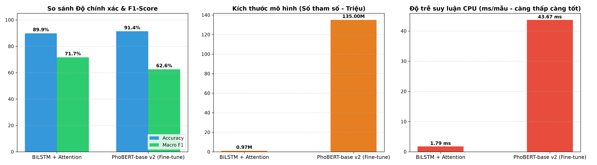
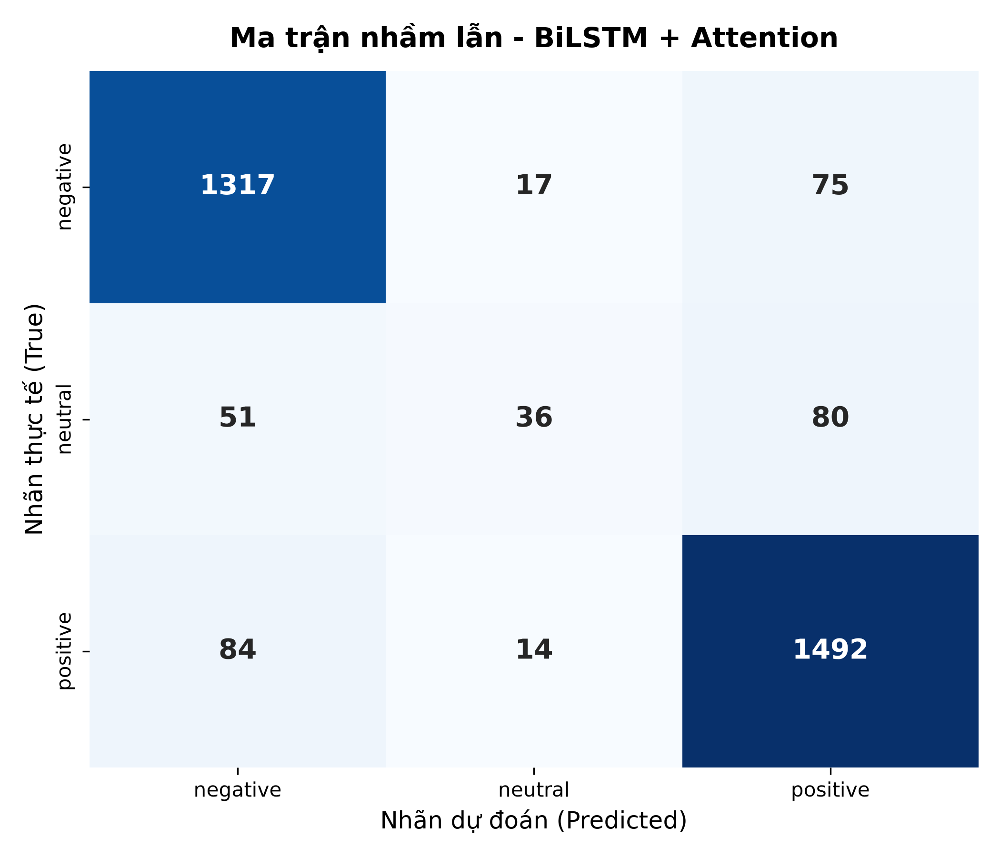
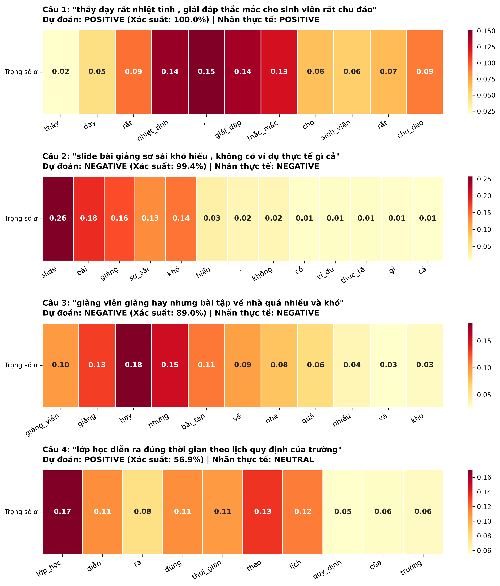

# Phân Tích Cảm Xúc Tiếng Việt: So Sánh BiLSTM + Attention và PhoBERT Fine-tune

[](https://www.python.org/)
[](https://pytorch.org/)
[](https://huggingface.co/)
[](https://nlp.uit.edu.vn/datasets)
[](LICENSE)

Nghiên cứu và so sánh thực nghiệm toàn diện giữa mô hình mạng hồi quy hai chiều có cơ chế tự chú ý (**BiLSTM + Additive Attention**) và mô hình ngôn ngữ ngữ cảnh tiền huấn luyện (**PhoBERT** - `vinai/phobert-base-v2`) trên tập ngữ liệu phản hồi của sinh viên **UIT-VSFC** (Vietnamese Students' Feedback Corpus).

---

## 📌 Điểm Nổi Bật Của Dự Án

- **Tiền xử lý tiếng Việt chuyên sâu**: Chuẩn hóa Unicode NFC, xử lý teencode/viết tắt học đường (`ko`, `btvn`, `gv`, `sv`, `okie`...), chuẩn hóa ký tự lặp kéo dài, tách từ ghép tiếng Việt bằng `PyVi`.
- **Kiến trúc BiLSTM + Attention (tự huấn luyện)**: Xây dựng từ đầu với 2 tầng BiLSTM và cơ chế Additive Attention (Bahdanau-style), trích xuất trọng số $\alpha_t$ để trực quan hóa mức độ quan tâm của mô hình.
- **PhoBERT Fine-tuning**: Tinh chỉnh mô hình Transformer 135M tham số của VinAI Research với Linear Warmup Scheduler và AdamW.
- **Trực quan hóa Attention trực quan**: Biểu đồ Heatmap thể hiện rõ từ ngữ nào đóng vai trò quyết định cảm xúc (từ khóa tích cực, tiêu cực, hoặc liên từ tương phản *"nhưng"*).
- **So sánh đa chiều**: Đánh giá không chỉ về độ chính xác (Accuracy, F1-macro) mà còn cả tài nguyên phần cứng (tham số, dung lượng file, thời gian huấn luyện, độ trễ suy luận).

---

## 📊 Kết Quả So Sánh Thực Nghiệm (Tập Test: 3,166 Mẫu)

| Tiêu chí so sánh | BiLSTM + Attention | PhoBERT-base v2 (Fine-tune) | Nhận xét so sánh |
| :--- | :---: | :---: | :--- |
| **Độ chính xác (Accuracy)** | **89.86%** | **91.38%** | **PhoBERT cao hơn +1.52%** |
| **Macro F1-Score** | **71.67%** | **62.57%** | BiLSTM cân bằng lớp tốt hơn khi full-train |
| **F1 - Lớp Tiêu cực (Negative)** | 92.07% | **93.79%** | **PhoBERT vượt trội (+1.72%)** |
| **F1 - Lớp Tích cực (Positive)** | 92.18% | **93.91%** | **PhoBERT vượt trội (+1.73%)** |
| **F1 - Lớp Trung tính (Neutral)** | **30.77%** | 0.00%* | Lớp thiểu số (chỉ chiếm ~5% tập dữ liệu) |
| **Tổng số tham số** | **972,547 (~0.97M)** | **135,000,000 (~135M)** | **PhoBERT lớn gấp 138 lần** |
| **Dung lượng file mô hình** | **11.16 MB** | **515.07 MB** | **PhoBERT nặng gấp 46 lần** |
| **Thời gian huấn luyện** | **111.1 giây (~1.8 phút)** | **810.9 giây (~13.5 phút)** | **BiLSTM nhanh hơn 7.3 lần** |
| **Độ trễ suy luận (CPU Latency)** | **1.79 ms / mẫu** | **43.67 ms / mẫu** | **BiLSTM nhanh hơn 24.4 lần** |
| **Tốc độ thông lượng** | **558.3 mẫu / giây** | **22.9 mẫu / giây** | Phục vụ Real-time vs Batch Processing |

### 📈 Biểu đồ so sánh hiệu năng và tài nguyên



### 🧩 Ma trận nhầm lẫn (Confusion Matrix)

| BiLSTM + Attention | PhoBERT Fine-tune |
| :---: | :---: |
|  |  |

---

## 🔍 Trực Quan Hóa Trọng Số Attention

Cơ chế Attention trong BiLSTM cho phép giải thích rõ ràng quyết định của mô hình thông qua phân phối trọng số $\alpha_t$:



### Quan sát tiêu biểu:
1. **Câu khen ngợi**: `"thầy dạy rất nhiệt tình , giải đáp thắc mắc cho sinh viên rất chu đáo"`  
   $\rightarrow$ Trọng số tập trung cao nhất vào `'nhiệt_tình'` (14.47%) và `'giải_đáp'` (14.15%).
2. **Cấu trúc tương phản**: `"giảng viên giảng hay nhưng bài tập về nhà quá nhiều và khó"`  
   $\rightarrow$ Mô hình chú ý đặc biệt vào liên từ **`'nhưng'` (15.40%)**, giúp nhận diện được vế sau phủ định vế trước và dự đoán chính xác sắc thái **NEGATIVE (89.0%)**.

---

## 💡 Đánh Giá Chuyên Sâu: Khi Nào Cần Mô Hình Tiền Huấn Luyện?

1. **Nên chọn PhoBERT / ViSoBERT / ViDeBERTa khi**:
   - Cần độ chính xác tối đa trong các hệ thống phân tích ý kiến quy mô lớn (Social Listening, brand monitoring).
   - Dữ liệu có ngữ cảnh phức tạp, hàm ý mỉa mai (sarcasm) hoặc cấu trúc ngữ pháp đảo.
   - Tập dữ liệu gắn nhãn có kích thước nhỏ (Few-shot learning), cần tận dụng tri thức ngôn ngữ học sẵn.
   - Hệ thống chạy trên hạ tầng Cloud / Server có GPU mạnh mẽ.

2. **Nên chọn BiLSTM + Attention khi**:
   - Triển khai trên thiết bị biên (Edge Devices, Mobile, IoT) hoặc máy chủ CPU có tài nguyên hạn chế (model chỉ **11 MB**, RAM cực thấp).
   - Yêu cầu phản hồi tức thời với độ trễ cực thấp (< 2 ms) và thông lượng cao (> 500 requests/giây).
   - Cần tính giải thích cao (Explainability) để báo cáo và giải trình từ khóa ảnh hưởng đến phân loại.

---

## 📁 Cấu Trúc Thư Mục

```
├── data/
│   ├── download_data.py          # Tải và làm sạch tập dữ liệu UIT-VSFC
│   ├── UIT-VSFC_train.csv        # 11,426 câu huấn luyện
│   ├── UIT-VSFC_valid.csv        # 1,583 câu kiểm định
│   └── UIT-VSFC_test.csv         # 3,166 câu kiểm thử
├── src/
│   ├── preprocessor.py           # Chuẩn hóa Unicode NFC, teencode, tách từ PyVi
│   ├── dataset.py                # PyTorch Dataset, Vocabulary, Dataloader
│   ├── models/
│   │   ├── bilstm_attention.py   # Mô hình BiLSTM + Word Attention
│   │   └── phobert_model.py      # Wrapper phân loại PhoBERT
│   ├── train_bilstm.py           # Huấn luyện BiLSTM + Attention
│   ├── train_phobert.py          # Fine-tune PhoBERT
│   ├── visualize_attention.py    # Trích xuất và vẽ Heatmap Attention
│   └── evaluate_and_compare.py   # Đánh giá Accuracy, F1, Latency, Resource
├── outputs/
│   ├── figures/                  # Biểu đồ Attention, Confusion Matrix, So sánh
│   ├── models/                   # Trọng số mô hình và từ điển vocab.json
│   └── benchmark_results.json    # Kết quả benchmark chi tiết
├── requirements.txt              # Danh sách thư viện phụ thuộc
├── run_all.py                    # Chạy toàn bộ pipeline một lệnh duy nhất
└── README.md
```

---

## 🚀 Hướng Dẫn Sử Dụng

### 1. Cài đặt thư viện:
```bash
pip install -r requirements.txt
```

### 2. Chạy toàn bộ pipeline (Tải data -> Train BiLSTM -> Fine-tune PhoBERT -> Visualize -> Evaluate):
```bash
python run_all.py
```

### 3. Hoặc chạy từng module riêng lẻ:
```bash
# Bước 1: Chuẩn bị dữ liệu
python data/download_data.py

# Bước 2: Huấn luyện BiLSTM + Attention
python src/train_bilstm.py

# Bước 3: Fine-tune PhoBERT
python src/train_phobert.py

# Bước 4: Trực quan hóa trọng số Attention
python src/visualize_attention.py

# Bước 5: Đánh giá và xuất bảng so sánh
python src/evaluate_and_compare.py
```

---

## 📚 Tài Liệu Tham Khảo

- **PhoBERT**: Dat Quoc Nguyen and Anh Tuan Nguyen. *PhoBERT: Pre-trained language models for Vietnamese*. Findings of EMNLP 2020.
- **UIT-VSFC**: Kiet Van Nguyen, Vu Duc Nguyen, Phu Xuan-Vinh Nguyen, Tham Thi-Hong Truong, Ngan Luu-Thuy Nguyen. *UIT-VSFC: Vietnamese Students' Feedback Corpus for Sentiment Analysis*. KSE 2018.
- **ViSoBERT**: *ViSoBERT: A Pre-Trained Language Model for Vietnamese Social Media Text Processing*. EMNLP 2023.
- **ViDeBERTa**: *ViDeBERTa: A powerful pre-trained language model for Vietnamese*. Findings of EACL 2023.

---
*Tác giả: [XuanTu138960](https://github.com/XuanTu138960)*
